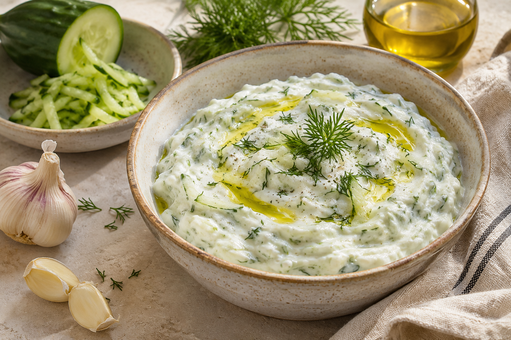

# Garlicky Dill Tzatziki

*AI-generated serving illustration.*

**Recipe Owner:**  
**Source:** Adapted from [Suzy Karadsheh / The Mediterranean Dish](https://www.themediterraneandish.com/tzatziki-sauce-recipe/), with a measured dill addition and adjustable garlic.  
**Date Made:**  
**Rating:**  
**Would Make Again:**  
**Prep time:** 15 min, plus 30 min–2 hours chilling  
**Cook time:** None  
**Servings:** About 8 generous 1/4-cup portions  
**Estimated macros:** ~75 cal | 5g protein | 5g fat | 3g carbs (per portion; rough estimate with 5% Greek yogurt)

### Ingredients
- 3/4 large English cucumber
- 1 teaspoon kosher salt, divided; adjust to taste
- 2 cups plain full-fat Greek yogurt
- 4 garlic cloves, finely grated (start with 2 for milder sauce)
- 1 teaspoon white vinegar
- 1 tablespoon extra-virgin olive oil, plus optional finishing drizzle
- 2 tablespoons finely chopped fresh dill
- 1/4 teaspoon black pepper

### Instructions
1. Grate cucumber and toss with 1/2 teaspoon salt. Wrap in a clean kitchen towel and wring very thoroughly; discard liquid.
2. Stir garlic, vinegar, oil, and remaining salt together. Fold in yogurt, squeezed cucumber, dill, and pepper.
3. Cover and refrigerate 30 minutes to 2 hours. Stir, taste, and adjust seasoning before serving. Finish with an optional little olive oil.

### Notes/Changes
- Untested in this kitchen. Aim for a thick sauce that stays on a spoon; draining the cucumber and using strained yogurt make the difference.
- Garlic intensifies as it rests. Start with 2 cloves if making ahead, then decide whether to add more after chilling.
- Refrigerate airtight and use within 2–4 days.
- Serve with [Homemade Pizza Oven Pita](pizza-oven-pita.md) and [Viral Döner Kebab](viral-doner-kebab.md).
- Dinner timing: mix pita dough first, make and chill the sauce during its rise, then bake the meat and cook pita close to serving.
