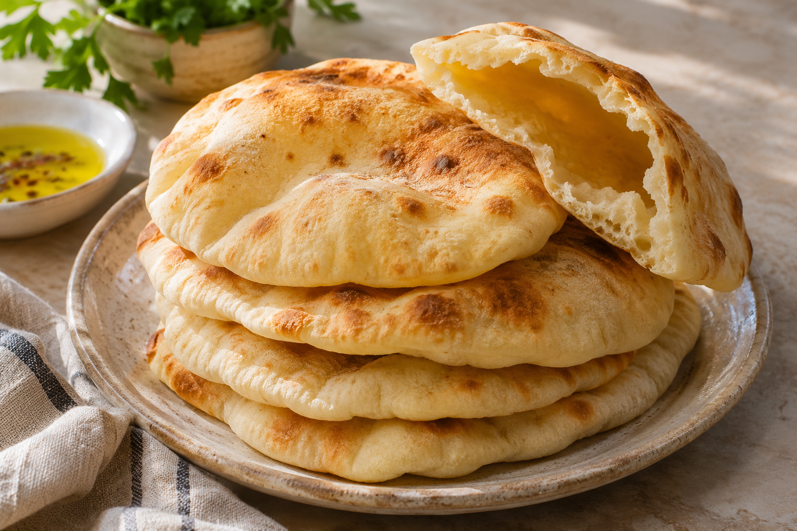

# Homemade Pita (Pizza Oven)

*AI-generated serving illustration.*

**Recipe Owner:**  
**Source:** Dough adapted from [King Arthur Baking / Golden Pita Bread](https://www.kingarthurbaking.com/recipes/golden-pita-bread-recipe); pizza-oven adjustments below are untested kitchen guidance.  
**Date Made:**  
**Rating:**  
**Would Make Again:**  
**Prep time:** 25 min active; about 1 hour 15 min rising/resting  
**Cook time:** Approximately 3–4 min per pita; varies with oven  
**Servings:** 8 pitas  
**Estimated macros:** ~200 cal | 5g protein | 4g fat | 36g carbs (per pita; calculated roughly from ingredients)

### Ingredients
- 360g all-purpose flour (3 cups), plus dusting flour
- 227g lukewarm water (1 cup)
- 2 teaspoons instant yeast
- 2 teaspoons sugar
- 9g table salt (1 1/2 teaspoons)
- 25g olive oil (about 2 tablespoons)

### Instructions
1. Mix all ingredients into a shaggy dough. Knead until smooth, about 10 minutes by hand or 5 minutes in a mixer. Cover; rise about 1 hour, until puffy.
2. Divide into eight balls, about 80g each. Cover and rest 15 minutes. Roll on a lightly floured counter into even 7-inch circles, about 1/8 inch thick. Avoid tears.
3. Preheat the pizza oven thoroughly. For this adaptation, start with a stone surface around 500–550°F (260–290°C), measured with an infrared thermometer. Use a low flame if adjustable; position bread away from direct flame.
4. Launch one pita directly onto the stone with a lightly floured peel. Cook until inflated and set, roughly 3–4 minutes at the lower temperature; inspect early and rotate as needed. Remove before it becomes crisp. Wrap the stack in a clean towel.

### Notes/Changes
- Untested in this kitchen. Oven model is unspecified; record stone temperature, flame setting, and actual bake time after the first batch.
- Use the first pita to tune heat: if it scorches before puffing, lower the flame or let the stone cool. If pale and slow to puff, allow the stone to recover heat. A pizza-hot 800–900°F stone is too aggressive for this starting method.
- Keep waiting dough covered. If it springs back while rolling, rest another 5–10 minutes. Use minimal dusting flour and brush excess off the peel to reduce scorching. Launch without parchment.
- Cool before storing airtight; keep up to 2 days at room temperature or freeze.
- Serve with [Viral Döner Kebab](viral-doner-kebab.md) and [Garlicky Dill Tzatziki](garlicky-dill-tzatziki.md).
